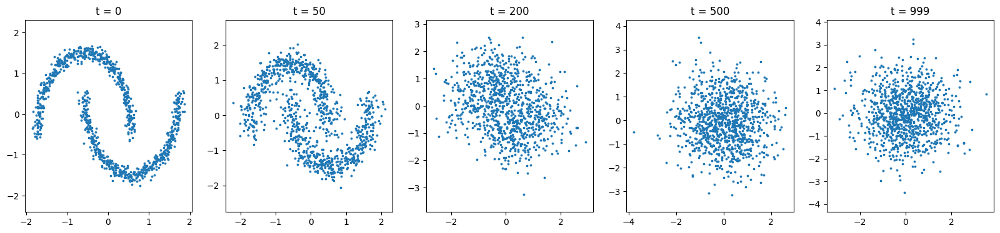
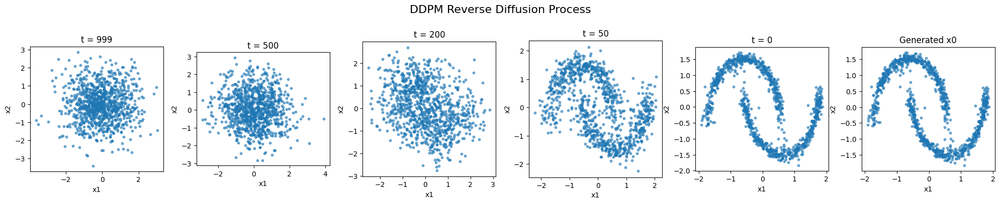
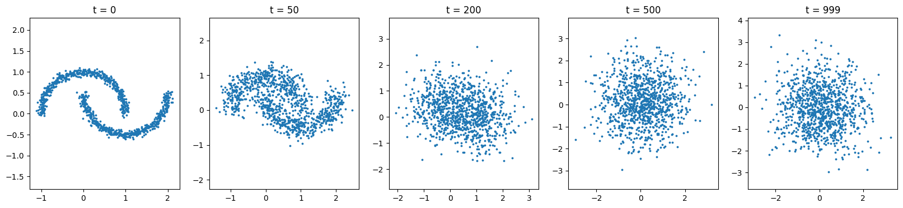
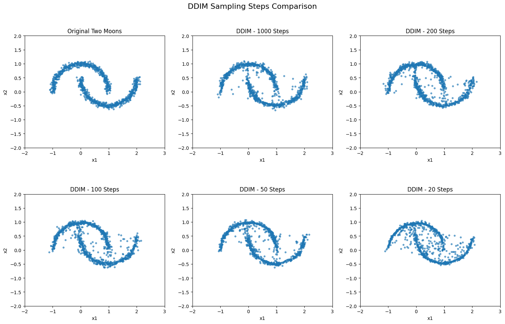

# Generative Modeling from Scratch

**Learning generative models through mathematical intuition, minimal PyTorch implementations, and controlled experiments.**

This repository documents my hands-on exploration of generative modeling, from fundamental equations to working samplers and empirical comparisons. It serves as both a learning record and a technical portfolio: the focus is on understanding **why an algorithm works**, implementing its essential components, and testing its behavior rather than relying on high-level model libraries.

The learning roadmap is informed by public diffusion-model lectures, including Stanford CME296-style materials, and original research papers. This is an independent learning project, not an official course repository or a claim of paper-level reproduction.

## Implementations

| Family | Method | Experiment | Focus | Notebook |
| --- | --- | --- | --- | --- |
| Diffusion | **DDPM** | Two Moons (2D) | Forward noising, noise prediction, stochastic reverse sampling | [`DDPM.ipynb`](diffusion/DDPM.ipynb) |
| Diffusion | **DDIM** | Two Moons (2D) | Reusing a noise-prediction model, deterministic sampling, timestep subsampling | [`DDIM.ipynb`](diffusion/DDIM.ipynb) |

The notebooks favor small, inspectable implementations over training large pretrained models.

## Key Ideas

**DDPM — learning to denoise.** The DDPM notebook explores how noise is added to data, how a neural network learns to predict that noise, and how stochastic reverse sampling can generate new Two Moons points.

**DDIM — exploring faster sampling.** The DDIM notebook uses the same noise-prediction model formulation and replaces the stochastic DDPM reverse process with a deterministic update. Experiments compare different numbers of sampling steps to examine how sample quality changes when fewer model evaluations are used.

Detailed derivations and implementation notes are kept inside the notebooks, while this README summarizes the project scope, experiments, and current progress.

## Results Gallery

### DDPM: forward noising process

The forward process gradually transforms structured Two Moons data into Gaussian-like noise.



### DDPM: generated samples

The learned noise predictor is used in a stochastic reverse process to sample new Two Moons-like points.



### DDIM: forward noising process

DDIM uses the same forward noising formulation and noise-prediction objective.



### DDIM: sampling-step comparison

Samples generated with **1,000, 200, 100, 50, and 20** DDIM steps are compared against the original Two Moons dataset. The experiment illustrates how the overall geometric structure can remain recognizable with fewer sampling steps, while sample quality and outliers may vary.



These plots are qualitative illustrations, not quantitative proof of distributional fidelity or a measured runtime speedup. Future comparisons may include fixed initial noise, DDPM baselines, and runtime/quality metrics.

## Adding New Result Images

When a notebook produces a meaningful result, export the figure to `assets/` and add it to the Results Gallery:

```markdown

```

Use descriptive filenames such as `ddim_two_moons_steps.png` or `flow_matching_2d_samples.png` so the README stays easy to maintain as the project grows.

## Learning Roadmap

The scope will expand as I study and implement topics from diffusion and broader generative-model literature. Planned topics are directions, not completed implementations.

| Area | Topics to explore | Status |
| --- | --- | --- |
| Diffusion | DDPM, DDIM | Implemented on Two Moons |
| Score-based modeling | Score estimation, SDE/ODE perspectives | Planned |
| Flow-based modeling | Flow Matching, Rectified Flow | Planned |
| Latent generative modeling | VAE, latent diffusion | Planned |
| Broader generative modeling | Additional topics from related papers and lectures | To be determined |

## Getting Started

The current repository contains Jupyter notebooks. To explore them locally:

```bash
git clone https://github.com/WhiteEyeBlackCat/generative-modeling-from-scratch.git
cd generative-modeling-from-scratch
```

Open `diffusion/DDPM.ipynb` or `diffusion/DDIM.ipynb` in JupyterLab, Jupyter Notebook, or VS Code. Typical dependencies include `torch`, `numpy`, `matplotlib`, `scikit-learn`, and `jupyter`.

Dependency versions are not yet pinned; inspect notebook imports before running.

## Repository Structure

```text
generative-modeling-from-scratch/
├── README.md
├── assets/
│   ├── ddim_forward_noising.png
│   ├── ddim_two_moons_steps.png
│   ├── ddpm_forward_noising.png
│   └── ddpm_two_moons_samples.png
└── diffusion/
    ├── DDIM.ipynb
    └── DDPM.ipynb
```

## References

- [Stanford CME296 — Diffusion Models & Large Vision Models](https://www.youtube.com/results?search_query=Stanford+CME296+Diffusion+Large+Vision+Models)
- Ho, Jain & Abbeel, [*Denoising Diffusion Probabilistic Models*](https://arxiv.org/abs/2006.11239) (2020)
- Song, Meng & Ermon, [*Denoising Diffusion Implicit Models*](https://arxiv.org/abs/2010.02502) (2020)

---

*This repository is a work in progress. The emphasis is on clear reasoning, reproducible experiments, and incremental understanding rather than production-ready implementations.*
